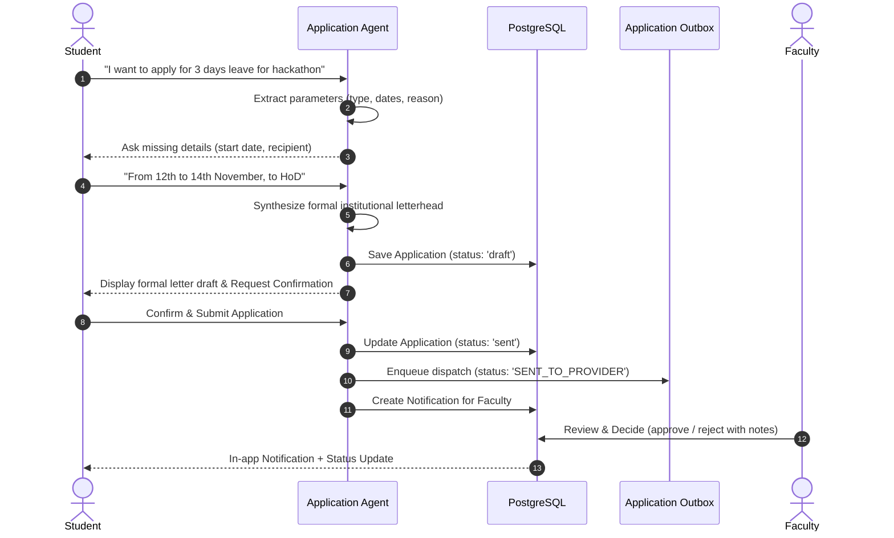

# Application Workflow & Institutional Outbox Queue Report
**PocketUni — MITS Gwalior**  
**Module:** Automated Student Applications & Dispatch Outbox

---

## 1. Overview

PocketUni replaces manual paper applications with a conversational, multi-turn AI application drafting and routing system. Students can draft official requests (Leave, Bonafide Certificate, NOC for Internship, Laboratory Access, and Department Permissions) through natural conversation, review formal letterheads, and dispatch them to faculty coordinators.

---

## 2. Multi-Turn Conversational Drafting Lifecycle

---

## 3. The Institutional Outbox Queue

All external transmissions to institutional email addresses are queued in the PostgreSQL `application_outbox` table to provide auditability, retry resilience, and delivery confirmation.

### Outbox Schema:
- `id`: VARCHAR(36) UUID
- `application_id`: ForeignKey linking to `applications.id`
- `recipient_email`: Target faculty or coordinator email (e.g. `@mitsgwalior.in`)
- `recipient_name`: Full name of receiving faculty
- `subject`: Standardized subject line (e.g. `[MITS PocketUni] Student Application: Leave Application - Aarav Sharma`)
- `body`: Full formal application text
- `status`: Lifecycle state:
  - `QUEUED`: Stored in outbox, awaiting transmission.
  - `SENT_TO_PROVIDER`: Relayed via institutional mail server / SMTP port 587.
  - `DELIVERED`: Acknowledged by receiving mailbox.
  - `FAILED`: Transmission error with logged retry count.
- `provider_response`: Gateway diagnostic message.
- `attempt_count`: Number of dispatch attempts.
- `dispatched_at`: Timestamp of transmission in UTC.

---

## 4. REST API Endpoints

| Method | Endpoint | Description |
|---|---|---|
| `POST` | `/api/v1/applications/agent-chat` | Multi-turn conversational drafting endpoint |
| `POST` | `/api/v1/applications/{app_id}/share` | Confirms draft, submits to faculty, and queues in outbox |
| `POST` | `/api/v1/applications/{app_id}/decision` | Faculty endpoint to approve or reject with feedback |
| `GET` | `/api/v1/applications/{app_id}/docx` | Downloads formal Word (.docx) document with MITS styling |
| `GET` | `/api/v1/applications/outbox/queue` | Super Admin / Audit endpoint to inspect the outbox queue |

---

## 5. Security & Academic Integrity Controls

1. **Explicit Student Confirmation:** Applications are **never** auto-submitted upon generation; students must explicitly review and confirm the draft.
2. **Identity Verification:** Applications automatically embed the student's authenticated institutional data (Roll Number, Enrollment Number, Branch, Semester, and Official Email).
3. **Immutable History:** Every state transition (`draft` -> `sent` -> `approved` / `rejected`) is immutably recorded in `application_status_history` with actor identity and timestamp.
