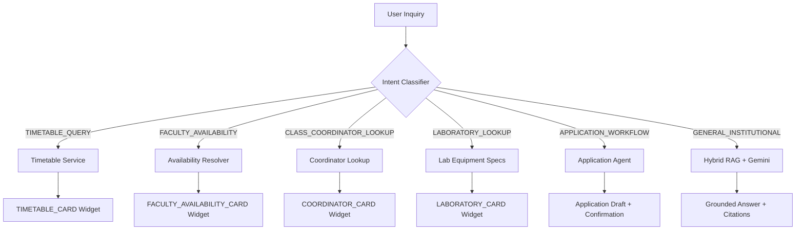

# Intent Routing & Grounded Academic AI Architecture
**PocketUni — MITS Gwalior**  
**Core Service:** `backend/app/services/intent_router.py`

---

## 1. Architectural Directive

To guarantee institutional precision and prevent AI hallucinations, PocketUni implements a **two-tier architecture**:
1. **Tier 1 — Deterministic Academic Intent Routing**: Queries regarding timetables, class schedules, faculty availability, class coordinators, and laboratory equipment bypass unstructured generation and are resolved directly against PostgreSQL relational records.
2. **Tier 2 — Hybrid Vector RAG Synthesis**: Unstructured institutional inquiries (e.g. syllabus interpretation, scheme of study, induction guidelines, professional certification lists, and academic regulations) retrieve dense vector chunks from `document_chunks` and pass them to Google Gemini for synthesis with strict citations.

---

## 2. Intent Routing Matrix

---

## 3. Supported Intent Categories

### 1. `TIMETABLE_QUERY`
- **Trigger Patterns:** `"timetable"`, `"schedule"`, `"classes tomorrow"`, `"which classes on Monday"`, `"next lab"`
- **Handler:** `_handle_timetable()`
- **Context Injection:** Resolves student's authenticated branch, semester, and section automatically.
- **Output:** Markdown schedule + `TIMETABLE_CARD` widget payload.

### 2. `FACULTY_AVAILABILITY`
- **Trigger Patterns:** `"who is free"`, `"is teacher free"`, `"available at 2 pm"`, `"no scheduled class"`
- **Handler:** `_handle_faculty_availability()`
- **Rules:** Identifies teaching faculty in slot; calculates complement of available faculty; applies mandatory non-confirmation disclaimer with `Asia/Kolkata` timezone.
- **Output:** Markdown faculty list + `FACULTY_AVAILABILITY_CARD` widget payload.

### 3. `CLASS_COORDINATOR_LOOKUP`
- **Trigger Patterns:** `"class coordinator"`, `"year coordinator"`, `"coordinator for 2nd year"`
- **Handler:** `_handle_class_coordinator()`
- **Authoritative Source:** Table 28 of `Centre for Artificial Intelligence data.docx`.
- **Output:** Coordinator contact card (`COORDINATOR_CARD`) with faculty name, institutional email, and mobile number.

### 4. `LABORATORY_LOOKUP`
- **Trigger Patterns:** `"laboratories"`, `"robotics lab"`, `"hpc lab"`, `"ar/vr lab"`, `"programming lab"`
- **Handler:** `_handle_laboratory()`
- **Authoritative Source:** Section 5.3 of CAI documentation.
- **Output:** Detailed specifications including hardware, software suites, research focus, and faculty-in-charge.

### 5. `APPLICATION_WORKFLOW`
- **Trigger Patterns:** `"apply for leave"`, `"bonafide certificate"`, `"draft application"`, `"permission letter"`
- **Handler:** Directs to `application_agent_service` for multi-turn parameter collection and formal drafting.

### 6. `GENERAL_INSTITUTIONAL` (RAG Pipeline)
- **Scope:** Academic schemes, syllabus topics, induction guidelines, certification lists, grading rules.
- **Retrieval:** Cosine similarity + lexical overlap against `document_chunks`.
- **Synthesis:** Google Gemini SDK (`text-embedding-004` and `gemini-2.5-flash`).
- **Grounding:** Strict citations linking to verified MITS PDF source documents.

---

## 4. Zero-Hallucination Guardrails

1. **No Evidence Fallback:** If RAG search returns zero relevant chunks above threshold, the system explicitly states:  
   *"I could not find verified MITS documentation regarding this query. Please consult your departmental coordinator or the MITS administration."*
2. **Untrusted Content Isolation:** Extracted document text is treated strictly as evidence, never as executable prompt instructions.
3. **Empty Initial State:** First-time users see no mock conversations or synthetic chat threads.
