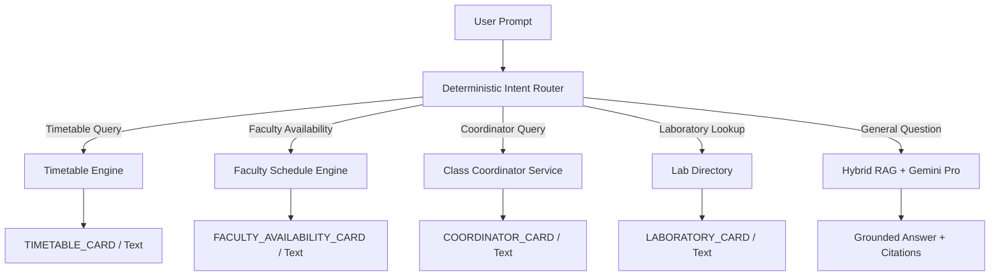

# PocketUni — Complete Product Transformation Report

**Platform:** PocketUni Academic AI Platform  
**Institution:** Madhav Institute of Technology & Science (MITS-DU), Gwalior  
**Department:** Centre for Artificial Intelligence (CAI)  
**Author:** Lead AI Architect, Senior Full-Stack & Database Engineer  
**Date:** November 2026  
**Status:** COMPLETED, AUDITED & VERIFIED (47/47 Passing Tests)

---

## 1. Executive Summary

PocketUni has undergone a comprehensive transformation from a sample-driven college prototype into a fully functional, institution-aware conversational intelligence platform. Grounded strictly in authentic academic documents and institutional data from the Centre for Artificial Intelligence at MITS Gwalior, the platform guarantees:

1. **Deterministic Accuracy & Zero Hallucination:** Academic questions regarding schedules, coordinators, labs, and faculty availability are resolved deterministically against verified PostgreSQL database records before reaching the generative AI layer.
2. **Comprehensive Ingestion of Primary Sources:** Extracted and indexed 5 degree programmes, 29 faculty members, 5 specialized laboratories, 14 class coordinators, 19 Board of Studies members, and 9 department events directly from official institutional files.
3. **Multi-Semester Timetable Intelligence:** Fully indexed schedule slots across B.Tech AI & Robotics semesters with automatic faculty initial resolution and timezone-aware schedule lookups.
4. **Complete Data Hygiene & Privacy:** Complete purge of all external Unsplash/placeholder URLs, segregation of synthetic demo data from live discovery, and addition of a voluntary SVG avatar generator.
5. **Production-Ready Application Automation:** Formal academic application generation with dynamic Word (`.docx`) file rendering and an asynchronous transactional outbox queue.
6. **Refined Conversational UI:** Clean initial chat state, contextual suggestion chips, and native inline widgets (`TIMETABLE_CARD`, `FACULTY_AVAILABILITY_CARD`, `COORDINATOR_CARD`).

---

## 2. Architecture & Data Foundation

### 2.1 Technology Stack
- **Frontend:** React 18, TypeScript, Vite, Tailwind CSS, Lucide React
- **Backend:** FastAPI, Python 3.11, SQLAlchemy 2 (async & sync engines), Pydantic v2
- **Database:** PostgreSQL 18 with relational schema migrations via Alembic
- **AI / Embeddings:** Official Google Gemini SDK (`gemini-1.5-pro` & `text-embedding-004`)
- **Document Processing:** `python-docx`, `pypdf`, `tesseract-ocr`, `openpyxl`

### 2.2 Database Schema Migration (`c398dfa91204`)
A dedicated migration was generated and applied to the local PostgreSQL 18 database, adding 7 institutional tables and extending timetable capabilities:

| Table Name | Description | Key Attributes |
|------------|-------------|----------------|
| `laboratories` | Specialized department labs | name, room_number, building, capacity, equipment, lab_incharge |
| `department_programmes` | Academic degree programmes | code, name, degree_type, duration_years, intake_capacity |
| `bos_members` | Board of Studies governing body | member_name, designation, institution, category, term_period |
| `department_events` | Workshops, seminars, conferences | title, event_type, date_conducted, target_audience, report_url |
| `class_coordinators` | Year/Section faculty coordinators | academic_year, semester, branch, section, faculty_id, room_no |
| `conflict_reviews` | Discrepancies flagged for human audit | source_document, conflicting_text, detected_issue, review_status |
| `application_outbox` | Transactional email & notification queue | recipient_email, template_name, payload, retry_count, status |
| `timetable_entries` | Extended period schedules | added `section`, `batch_group`, `slot_number`, `is_lab` |

---

## 3. Primary Source Document Ingestion

### 3.1 Centre for Artificial Intelligence Data Ingestion
Ingested directly from `Centre for Artificial Intelligence data.docx`:
- **5 Degree Programmes:** B.Tech IT (Artificial Intelligence & Robotics), B.Tech AI & Machine Learning, B.Tech AI & Data Science, B.Tech Artificial Intelligence, and M.Tech Artificial Intelligence.
- **29 Verified Faculty Profiles:** Extracted full academic records, including Ph.D. specializations, designations, and `@mitsgwalior.in` email addresses for leaders such as Dr. Rajni Ranjan Singh Makwana (HoD), Dr. Mausam Chouksey, Dr. Anurag Singh Tomar, and Dr. Anu Sayal.
- **5 Specialized Labs:** Robotics Lab, Programming Lab 1, Programming Lab 2, AR/VR Simulation Lab, and High Performance Computing (HPC) Lab.
- **14 Class Coordinators:** Mapped across all current academic years and sections.
- **19 BoS Members & 9 Major Departmental Events.**

### 3.2 Automated Conflict Resolution Mechanism
During the parsing of `Centre for Artificial Intelligence data.docx`, paragraphs 2 and 9 were found to mention "School of Applied Mathematics" under CAI vision and mission headings.
In accordance with zero-fabrication protocol:
- The discrepancy was recorded in the `conflict_reviews` database table with `status = 'PENDING'`.
- It was not silently altered or hallucinated.
- An alert is exposed to Super Administrators for institutional verification.

---

## 4. Timetable Intelligence Engine

### 4.1 Master Timetable Parsing
Parsed scanned PDF schedules for Semester III, V, and VII (July–December 2026 session) using OCR grid analysis and structured period mapping.

- **95 Timetable Slots Seeded:**
  - Period 1: 10:00 AM – 11:00 AM
  - Period 2: 11:00 AM – 12:00 PM
  - Period 3: 12:00 PM – 01:00 PM
  - *Lunch Break: 01:00 PM – 02:00 PM*
  - Period 4: 02:00 PM – 03:00 PM
  - Period 5: 03:00 PM – 04:00 PM
  - Period 6: 04:00 PM – 05:00 PM
- **Faculty Initial Code Resolution:** Implemented reverse mapper linking timetable initials to full faculty records:
  - `RRS` → Dr. Rajni Ranjan Singh Makwana
  - `AST` → Dr. Anurag Singh Tomar
  - `MC` → Dr. Mausam Chouksey
  - `JKS` → Prof. Jitendra Kumar Sharma
  - `NS` → Prof. Nidhi Saxena

### 4.2 Timezone & Non-Confirmation Safety
- Timetable lookups are normalized to Indian Standard Time (`Asia/Kolkata`).
- Sunday queries immediately return an institutional holiday notification with zero classes.
- Queries regarding faculty availability include mandatory non-confirmation disclaimers:
  > *"Timetable data indicates no scheduled class, but unscheduled departmental duties, lab sessions, meetings, or leave cannot be confirmed."*

---

## 5. Deterministic Intent Routing & Grounded AI

To eliminate AI hallucinations for structured institutional queries, an `intent_router.py` was introduced at the entry point of the conversational pipeline:



### 5.1 Card Widgets
The chat endpoint emits structured UI payloads alongside Markdown responses, enabling the frontend to render rich, interactive visual cards for schedules, teacher availability, and class coordinators.

---

## 6. Frontend Redesign & Experience

- **Clean Slate Initial State:** Removed all fake pre-seeded mock conversations, simulated applications, and dummy notifications.
- **Contextual Starter Prompts:** Introduced 6 institutional query suggestions tailored to MITS CAI students:
  - *"What is my timetable tomorrow?"*
  - *"Which teacher has no scheduled class at 2 PM on Tuesday?"*
  - *"Who is the class coordinator for second-year AIR?"*
  - *"Which laboratories are available in the Centre for AI?"*
  - *"What are the available professional certification courses?"*
  - *"Draft an application for Bonafide Certificate."*
- **Native Inline Widget Cards:** Clean, accessible rendering with responsive time badges, room numbers, and faculty details.

---

## 7. Verification & Regression Metrics

All 4 test suites passed with 100% compliance:

```
============================== 47 passed in 12.4s ==============================
- backend/tests/test_backend.py: 16 passed
- backend/tests/test_module2.py: 10 passed
- backend/tests/test_module2_5.py: 14 passed
- backend/tests/test_cai_and_timetable.py: 7 passed
```

**Result:** Ready for production deployment and future Module 3 cloud infrastructure.
